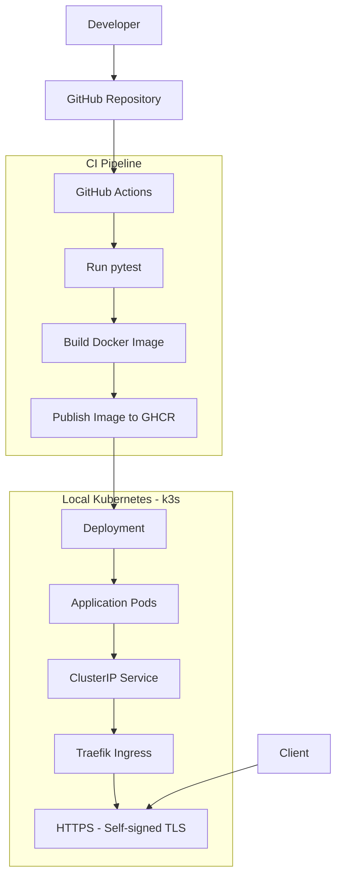

# DevOps-platform

A personal DevOps portfolio project demonstrating Docker containerization, GitHub Actions CI automation, container image publishing, Kubernetes deployment, access control, and Infrastructure as Code using Terraform in local and real AWS lab environments.

> **Project scope:** This is a personal learning and portfolio project, not commercial DevOps experience. Kubernetes was deployed to a local `k3s` cluster. Terraform module practice was performed using Floci, a local AWS-compatible environment. A separate Terraform lab was deployed and validated in a real AWS account. These are learning exercises, not production or commercial deployments.

## Project Goals

- Containerize a Flask application using Docker.
- Automate testing and Docker image builds with GitHub Actions.
- Publish container images to GitHub Container Registry (GHCR).
- Deploy the application to a local Kubernetes (`k3s`) cluster.
- Demonstrate health checks, resource controls, Ingress/TLS, and least-privilege RBAC.
- Practise reusable Terraform modules and safe resource refactoring.
- Build and validate AWS network infrastructure using Terraform.
- Practise remote Terraform state management using an encrypted and versioned S3 backend.

## Technology Stack

| Area | Technologies |
|---|---|
| Application | Python, Flask, Gunicorn |
| Containers | Docker |
| CI/CD | GitHub Actions, pytest |
| Container Registry | GitHub Container Registry (GHCR) |
| Orchestration | Kubernetes (`k3s`), Deployments, ReplicaSets, Pods, Services |
| Networking | Traefik Ingress, HTTP/HTTPS, TLS |
| Configuration | ConfigMaps, `imagePullSecrets` |
| Reliability | Readiness/liveness probes, CPU and memory requests/limits |
| Access Control | ServiceAccounts, Roles, RoleBindings, Kubernetes RBAC |
| Infrastructure as Code | Terraform, modules, variables, outputs, lifecycle rules, `moved` block |
| AWS Infrastructure | VPC, Subnets, Internet Gateway, Route Tables, Security Groups |
| Terraform Backend | Amazon S3 remote backend, versioning, encryption, state locking |
| Local Cloud-Compatible Practice | Floci |

## Architecture



This diagram shows the application workflow. The AWS VPC lab is a separate infrastructure exercise and is documented in the Terraform section below. Refer to the actual workflow files and Terraform configuration for exact implementation details.

## Application

The Flask application is version `1.0.0` and listens on container port `8080`.

| Endpoint | Purpose |
|---|---|
| `/` | Application root |
| `/health` | Health check |
| `/ready` | Readiness check |
| `/info` | Application information |
| `/metrics` | Metrics endpoint |

The container uses Python 3.14 slim and Gunicorn.

## CI/CD

The GitHub Actions CI workflow is configured for pushes and pull requests targeting `main`. The confirmed CI tasks include running `pytest` and building a Docker image. Image publishing to GHCR has also been configured.

The repository workflow files are the source of truth for the exact triggers, permissions, image tags, and job steps.

### Run Tests Locally

From the repository root, with the project's Python test dependencies installed:

```bash
pytest
```

### Build the Docker Image

Run from the repository root:

```bash
docker build -f docker/Dockerfile -t devops-platform:ci-test .
```

The final `.` is the Docker build context: the repository root.

### Run the Container Locally

```bash
docker run --rm -p 8080:8080 devops-platform:ci-test
```

In another terminal, test the application:

```bash
curl http://localhost:8080/health
curl http://localhost:8080/ready
curl http://localhost:8080/info
```

These commands assume host port `8080` is available. Stop the foreground container with `Ctrl+C`.

## Kubernetes Deployment

The application has been deployed to a **local `k3s` cluster**.

The demonstrated configuration includes:

- A Deployment with two replicas in the verified project state.
- A ClusterIP Service mapping port `80` to container port `8080`.
- A Traefik Ingress for `devops-platform.local`.
- TLS using a self-signed certificate for local testing.
- A ConfigMap for application settings, including environment and version.
- An `imagePullSecret` for a private GHCR image.
- Readiness and liveness probes using `/ready` and `/health`.
- CPU and memory requests and limits.
- A dedicated deployment ServiceAccount with namespace-scoped RBAC.

The self-signed certificate is for lab use and is not publicly trusted. This is not a public production service.

### Verify a Deployment

Ensure `kubectl` targets the intended local cluster.

```bash
kubectl get deployments,pods,services,ingress
kubectl get events --sort-by=.metadata.creationTimestamp
kubectl describe deployment devops-platform
kubectl rollout status deployment/devops-platform
```

Resource names may need to be adjusted if the manifests have changed. The hostname `devops-platform.local` requires appropriate local name resolution on the machine making the request.

## Security and Reliability

### Least-Privilege Access

A dedicated Kubernetes ServiceAccount and namespace-scoped RBAC are used for deployment rather than broad administrator permissions.

The goal is to restrict the actions available to the deployment identity and reduce the potential blast radius of a compromised credential.

Review the current Role and RoleBinding manifests before describing the exact permissions granted.

### Container Registry Credentials

The Kubernetes workload uses an `imagePullSecret` to authenticate to a private GHCR image.

Never commit registry tokens, credentials, private keys, or other secrets to Git.

### Health Checks and Resource Controls

Readiness and liveness probes help Kubernetes determine whether the application should receive traffic and whether a container needs restarting.

CPU and memory requests and limits make resource expectations explicit and help prevent uncontrolled resource consumption.

### Terraform State and Secrets

Do not commit credentials, access tokens, private keys, `.env` files, Terraform state files, or secret variable files.

Terraform state can contain infrastructure metadata and sensitive values. Real or team environments require an appropriate state-storage design, access control, encryption, and locking.

## Terraform Module Practice

Terraform module practice focused on a reusable S3 bucket module, module inputs and outputs, lifecycle safeguards, and resource refactoring with a `moved` block.

The refactoring plan was verified as:

```text
Plan: 0 to add, 0 to change, 0 to destroy.
```

This demonstrated that the resource-address refactor in that exercise did not plan resource recreation.

The initial module practice used **Floci**, a local AWS-compatible environment. Floci is kept separate from the real AWS lab and is not a substitute for validating infrastructure in AWS.

## AWS Terraform VPC Lab

A separate networking lab was deployed to a real AWS account using Terraform.

**Region:** `eu-west-1` (Ireland)

**Purpose:** Practise AWS VPC networking, subnet segmentation, route tables, Internet Gateway configuration, Security Groups, and remote Terraform state management.

### Network Architecture

The lab contains one VPC with a CIDR range of `10.0.0.0/16`.

| Resource | CIDR / Configuration | Availability Zone |
|---|---|---|
| VPC | `10.0.0.0/16` | `eu-west-1` (Ireland) |
| Public Subnet A | `10.0.1.0/24` | `eu-west-1a` |
| Public Subnet B | `10.0.2.0/24` | `eu-west-1b` |
| Private Subnet A | `10.0.11.0/24` | `eu-west-1a` |
| Private Subnet B | `10.0.12.0/24` | `eu-west-1b` |

The public and private subnets are distributed across two Availability Zones.

### Public Network

The public subnets are associated with a dedicated public route table.

The public route table contains:

| Destination | Target | Purpose |
|---|---|---|
| `10.0.0.0/16` | `local` | Internal VPC communication |
| `0.0.0.0/0` | Internet Gateway | Default IPv4 route towards the internet |

An Internet Gateway is attached to the VPC.

Public subnets have `map_public_ip_on_launch = true`.

A route to an Internet Gateway is necessary for public IPv4 internet connectivity, but it does not by itself guarantee connectivity. A workload also needs an appropriate public IP address and permissive Security Group and Network ACL rules.

### Private Network

The private subnets are associated with a separate private route table.

The private route table contains only the VPC local route:

| Destination | Target | Purpose |
|---|---|---|
| `10.0.0.0/16` | `local` | Internal VPC communication |

Private subnets have `map_public_ip_on_launch = false`.

No default route to the Internet Gateway or NAT Gateway is configured. Therefore, these subnets do not have a direct IPv4 internet route in this lab configuration.

A NAT Gateway was intentionally not created to avoid unnecessary ongoing lab costs.

### Security Group

A Security Group was created for public lab resources.

| Direction | Protocol | Port | Source / Destination |
|---|---|---|---|
| Inbound | TCP | 80 | `0.0.0.0/0` |
| Inbound | TCP | 443 | `0.0.0.0/0` |
| Inbound | SSH (TCP) | 22 | Not allowed |
| Outbound | All traffic | All | `0.0.0.0/0` |

HTTP and HTTPS ingress are open to all IPv4 addresses for this lab configuration. SSH ingress was deliberately not enabled.

Security Groups are stateful: response traffic for an allowed connection is automatically permitted.

### Terraform Remote Backend

The lab uses an Amazon S3 remote backend for Terraform state.

The backend bucket is configured with:

- S3 bucket versioning.
- Server-side encryption using SSE-S3 (AES-256).
- S3 Block Public Access.
- S3 state locking with `use_lockfile = true`.

The VPC lab state is stored under a separate key in the backend bucket. The bootstrap configuration that manages the backend bucket keeps its own state separate.

Terraform state files and temporary backend lock files (`*.tflock`) are not committed to Git. Terraform provider dependency lock files (`.terraform.lock.hcl`) are committed to ensure consistent provider versions.

### Validation

The infrastructure was applied using Terraform and verified using both Terraform and AWS CLI.

Confirmed checks included:

- VPC existence and CIDR configuration.
- Four subnet CIDR ranges, Availability Zones, and public IP assignment settings.
- Internet Gateway attachment to the VPC.
- Public route table default route through the Internet Gateway.
- Private route table containing only the local route.
- Associations between all four subnets and their intended route tables.
- Security Group ingress and egress rules.
- Terraform state containing the expected resources.

The final Terraform plan reported:

```text
No changes. Your infrastructure matches the configuration.
```

This confirms that Terraform configuration and the observed AWS infrastructure matched at the time of validation.

### Reproduce and Inspect

Run the commands from the AWS lab directory:

```bash
cd terraform/labs/01-vpc
```

Authenticate using the configured AWS CLI SSO profile:

```bash
aws sso login --profile devops-platform
aws sts get-caller-identity --profile devops-platform
```

Initialize Terraform and inspect the state:

```bash
terraform init
terraform state list
```

Validate and inspect the planned infrastructure:

```bash
terraform fmt -check
terraform validate
terraform plan
```

Inspect VPCs and subnets:

```bash
aws ec2 describe-vpcs \
  --filters "Name=tag:Project,Values=devops-platform" \
  --profile devops-platform

aws ec2 describe-subnets \
  --filters "Name=vpc-id,Values=<VPC_ID>" \
  --profile devops-platform
```

Replace `<VPC_ID>` with the VPC ID from the previous command.

### Lab Limitations

- This is a learning lab in a real AWS account, not a production deployment.
- No EC2 instances or application workloads were deployed in this VPC.
- No NAT Gateway was created.
- End-to-end application connectivity and public internet access were not tested.
- The Security Group rules are demonstration settings and should be restricted appropriately for real workloads.
- AWS resource costs depend on the services and resources deployed. The lab avoids EC2 and NAT Gateway charges, but this should not be interpreted as a guarantee of zero AWS costs.

## Troubleshooting

### ImagePullBackOff

Check the image name and tag, registry visibility, and `imagePullSecret` credentials in the correct namespace.

### Pod Not Ready

Inspect pod events and logs. Verify probe paths, application startup, and the container port.

### Ingress or HTTPS Failure

Check the Ingress host rule, Traefik status, TLS secret, local name resolution, and Service routing.

### Unexpected Terraform Plan

Inspect configuration, state, and the real environment before applying. Review every planned creation, update, replacement, or deletion.

Useful Kubernetes diagnostic commands:

```bash
kubectl get pods
kubectl describe pod <pod-name>
kubectl logs <pod-name>
kubectl get events --sort-by=.metadata.creationTimestamp
```

Replace `<pod-name>` with the actual pod name. Never paste secret values into public issues or logs.

## Evidence and Validation

Useful evidence for reviewers includes:

- A successful GitHub Actions run showing tests and image build.
- Workflow YAML showing explicit permissions.
- The GHCR package/image corresponding to the documented version or tag.
- Kubernetes manifests for Deployment, Service, Ingress, probes, resource controls, and RBAC.
- Sanitized rollout output and successful health checks.
- Terraform module configuration and plan output demonstrating the `moved`-block refactor.
- AWS VPC Terraform configuration, route table definitions, and sanitized validation output.
- Terraform plan output confirming that the AWS infrastructure matches the configuration.

Only add badges or screenshots that point to real, current results. Never include tokens, credentials, private keys, account identifiers, or sensitive state information.

## Known Limitations

- Kubernetes runs in a local `k3s` lab, not a managed production cluster.
- Local Ingress uses a self-signed TLS certificate.
- Monitoring components were tested in the constrained lab, but the monitoring stack was removed and is not presented as a continuously running service.
- Floci is used for local AWS-compatible Terraform practice and is not a substitute for validation in real AWS.
- The AWS VPC lab is a separate educational deployment. It does not include EC2 workloads, NAT Gateway, or end-to-end application connectivity testing.
- This is a personal portfolio project, not commercial DevOps employment.

## Links

- **GitHub Profile:** https://github.com/grim-82
- **Project Repository:** https://github.com/grim-82/devops-platform

Keep this README aligned with the current source code, workflow files, Kubernetes manifests, test results, Terraform configuration, and actual lab state.
